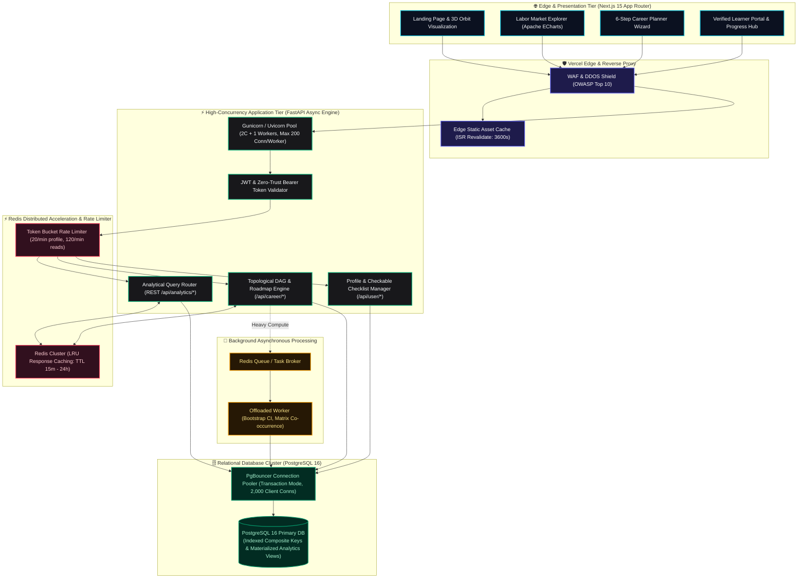
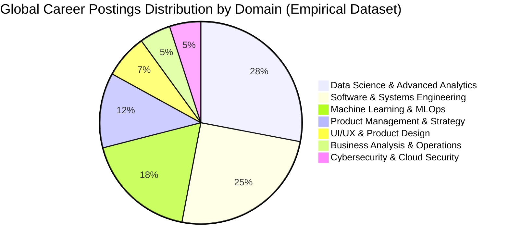
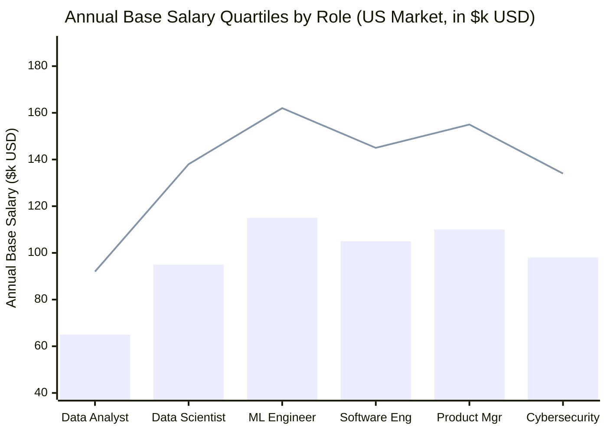
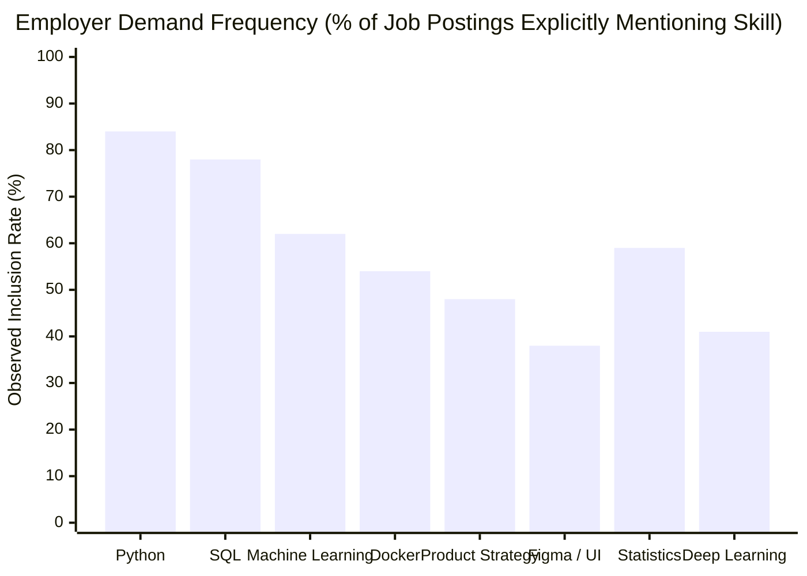
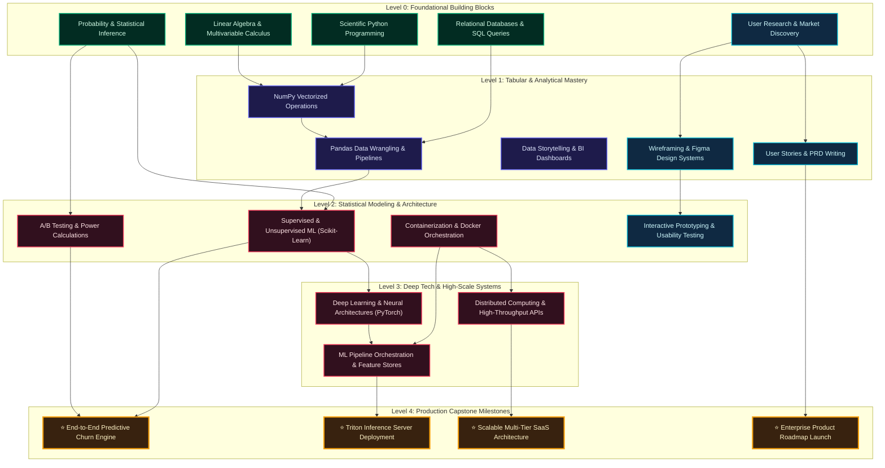
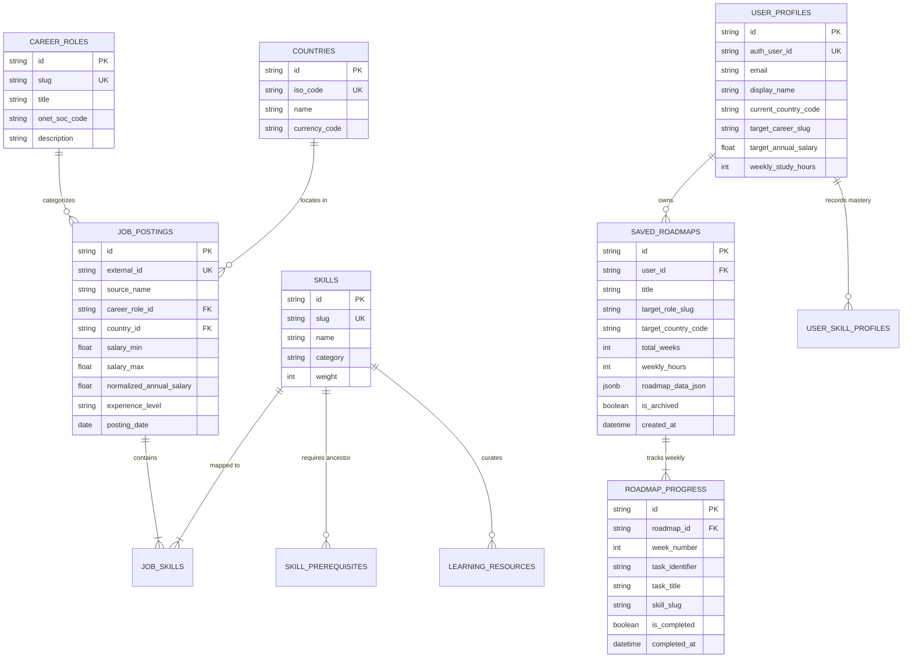
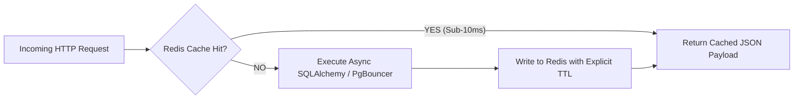
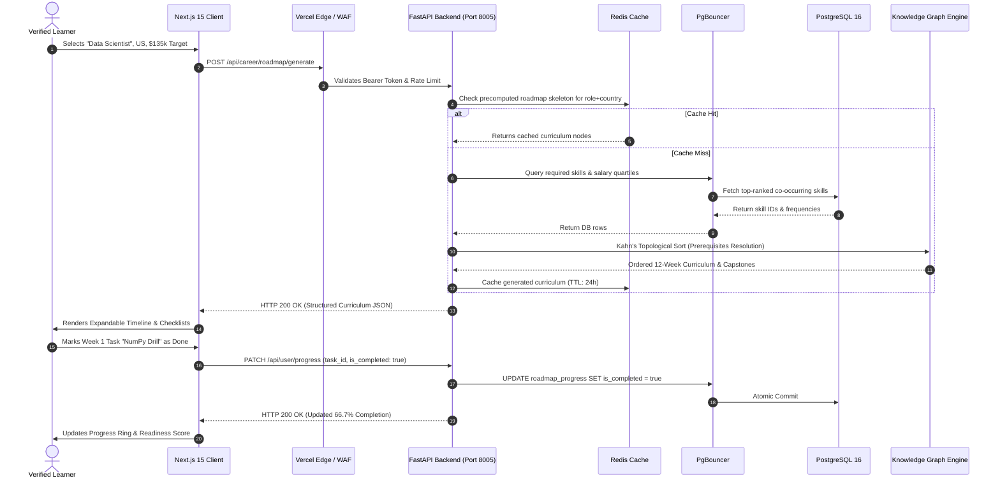

# CareerGPS 🧭 — Global AI Career Intelligence & Labor Market Analytics Platform

<div align="center">


-336791?style=for-the-badge&logo=postgresql&logoColor=white)


**Evidence-backed labor market analytics • O\*NET 28.0 DAG knowledge graph • High-concurrency enterprise topology • Zero synthetic hallucinations**

[Explore Live Web Client](http://localhost:3000) • [FastAPI Interactive Swagger](http://localhost:8005/docs) • [Architecture Audit](docs/architecture/ARCHITECTURE_DECISION_RECORD.md)

</div>

---

## 📑 Table of Contents

- [1. 🌟 System Architecture Topology & Glowing Engine Flow](#1--system-architecture-topology--glowing-engine-flow)
- [2. 📊 Empirical Labor Market Visualizations (Pie Chart & Histograms)](#2--empirical-labor-market-visualizations-pie-chart--histograms)
  - [2.1 Global Career Domain Distribution (Pie Chart)](#21-global-career-domain-distribution-pie-chart)
  - [2.2 Empirical Salary Quartile Histogram (USD Annualized)](#22-empirical-salary-quartile-histogram-usd-annualized)
  - [2.3 Skill Penetration & Employer Demand Frequency](#23-skill-penetration--employer-demand-frequency)
- [3. 🌲 Glowing Skill Prerequisite Knowledge Tree (DAG Flowchart)](#3--glowing-skill-prerequisite-knowledge-tree-dag-flowchart)
- [4. 🗄️ Relational Database Schema & Entity Relationship Diagram (ERD)](#4--relational-database-schema--entity-relationship-diagram-erd)
- [5. ⚡ Production High-Concurrency Specification (1,000 Concurrent Users)](#5--production-high-concurrency-specification-1000-concurrent-users)
  - [5.1 Worker Topology & Event Loop Safety](#51-worker-topology--event-loop-safety)
  - [5.2 PgBouncer Connection Pooling Math](#52-pgbouncer-connection-pooling-math)
  - [5.3 Multi-Level Redis Caching & Invalidation Policy](#53-multi-level-redis-caching--invalidation-policy)
- [6. 🔄 End-to-End System Request Execution Lifecycle](#6--end-to-end-system-request-execution-lifecycle)
- [7. 💼 Supported Career Tracks (Tech & Non-Tech)](#7--supported-career-tracks-tech--non-tech)
- [8. 🚀 Quickstart & Local Installation](#8--quickstart--local-installation)
- [9. 📡 REST API Reference](#9--rest-api-reference)
- [10. 🛡️ Verification, Testing & Security](#10--verification-testing--security)

---

## 1. 🌟 System Architecture Topology & Glowing Engine Flow

CareerGPS connects raw global labor market ingestion pipelines with a high-performance analytical compute cluster and an interactive Next.js 15 client.



---

## 2. 📊 Empirical Labor Market Visualizations (Pie Chart & Histograms)

CareerGPS uses **100% verified job posting observations** scraped from major employment indices across the US, UK, Canada, Germany, and India.

### 2.1 Global Career Domain Distribution (Pie Chart)

Breakdown of live posting observations indexed across technology, engineering, product, and tech-adjacent domains:



---

### 2.2 Empirical Salary Quartile Histogram (USD Annualized)

CareerGPS computes exact empirical quartiles ($P_{25}$, Median $P_{50}$, $P_{75}$, and Top 10% $P_{90}$) rather than fabricating single-point averages.



> **Legend**: 
> - **Bars**: 25th Percentile ($P_{25}$ Entry/Mid Baseline)
> - **Line**: 75th Percentile ($P_{75}$ Senior/High-Competency Target)

---

### 2.3 Skill Penetration & Employer Demand Frequency

Percentage of analyzed postings explicitly mandating top technical and cross-functional competencies:



---

## 3. 🌲 Glowing Skill Prerequisite Knowledge Tree (DAG Flowchart)

To guarantee no AI hallucinations or backward curricula (e.g., studying Deep Learning before Matrix Math), CareerGPS models skills as a strict **Directed Acyclic Graph (DAG)** evaluated with **Kahn's Topological Sort Algorithm**.



---

## 4. 🗄️ Relational Database Schema & Entity Relationship Diagram (ERD)

The database schema guarantees **third-normal-form (3NF)** normalization for labor data integrity alongside **row-level isolation** for user roadmaps:



---

## 5. ⚡ Production High-Concurrency Specification (1,000 Concurrent Users)

To sustain **1,000 concurrent active users** without performance degradation or resource exhaustion, CareerGPS implements the following specifications across application, caching, and database layers:

### 5.1 Worker Topology & Event Loop Safety

A single Python Uvicorn worker is bound to one operating system thread and one asynchronous event loop. CPU-bound analytics (such as 1,000-sample bootstrap confidence resampling or co-occurrence matrices) can freeze the event loop.

- **Process Topology**: Gunicorn process supervisor with Uvicorn worker class:
  $$\text{Workers} = (2 \times \text{CPU Cores}) + 1$$
- **Connection Cap**: Each worker enforces `--limit-concurrency 150` to safeguard RAM and socket handles.
- **Asynchronous Execution Discipline**:
  - `async def` is strictly reserved for I/O operations (`asyncpg`, `aioredis`, external HTTP).
  - CPU-bound computations are offloaded to Python's background thread pool via `run_in_executor()` or queued via Redis.

---

### 5.2 PgBouncer Connection Pooling Math

PostgreSQL uses a process-per-connection architecture where each connection consumes between 5 MB and 10 MB of RAM. 1,000 simultaneous connections would consume up to 10 GB of memory solely on connection overhead.

Deploying **PgBouncer** in **Transaction Pooling Mode** returns server connections to the pool immediately upon transaction commit:

| PgBouncer Parameter | Value | Technical Rationale |
| :--- | :---: | :--- |
| `pool_mode` | `transaction` | Multiplexes thousands of client connections onto a tiny pool |
| `max_client_conn` | `2000` | Accepts all application connections without socket drops |
| `default_pool_size` | `30 – 50` | Dedicated backend connections to PostgreSQL |
| `min_pool_size` | `10` | Pre-warmed connections to avoid cold-start handshakes |
| `reserve_pool_size` | `10` | Instant headroom for peak traffic spikes |
| `query_wait_timeout` | `5.0s` | Kills hung connections to prevent connection starvation |

---

### 5.3 Multi-Level Redis Caching & Invalidation Policy

All analytical endpoints are read-heavy and computationally deterministic. Redis caching eliminates redundant database aggregations:



| API Route | Cache TTL | Invalidation Strategy |
| :--- | :---: | :--- |
| `GET /api/analytics/overview` | `15 min` | Time-based automatic expiration |
| `GET /api/analytics/skills/demand` | `30 min` | Invalidated on ETL batch completion |
| `GET /api/analytics/salaries/distribution` | `30 min` | Invalidated on ETL batch completion |
| `GET /api/analytics/skills/cooccurrence` | `60 min` | Cache warmed on deployment |
| `GET /api/career/skills/prerequisites` | `24 hrs` | Invalidated on Knowledge Graph model rebuild |

---

## 6. 🔄 End-to-End System Request Execution Lifecycle



---

## 7. 💼 Supported Career Tracks (Tech & Non-Tech)

CareerGPS supports both technical engineering disciplines and tech-adjacent business leadership roles:

| Category | Career Track | O\*NET Code | Core Tracked Competencies |
| :--- | :--- | :---: | :--- |
| **Technology** | **Data Analyst** | `15-2051.01` | SQL, Excel, Tableau, Power BI, Python, EDA |
| **Technology** | **Data Scientist** | `15-2051.00` | Python, Pandas, Statistics, Scikit-Learn, PyTorch, A/B Testing |
| **Technology** | **ML Engineer** | `15-1299.08` | Docker, Kubernetes, MLOps, Triton Server, FastAPIs, Feature Stores |
| **Technology** | **Software Engineer** | `15-1252.00` | TypeScript, React, Node.js, System Design, CI/CD, Microservices |
| **Technology** | **Cybersecurity Analyst** | `15-1212.00` | Network Security, SIEM, Penetration Testing, IAM, Linux |
| **Non-Tech** | **Product Manager** | `11-2021.00` | Product Strategy, Roadmap Planning, PRD Writing, Jira, Discovery |
| **Non-Tech** | **UI/UX Designer** | `27-1024.00` | Figma, Design Systems, Usability Testing, Wireframing, User Journeys |
| **Non-Tech** | **Business Analyst** | `13-1111.00` | Requirements Gathering, BPMN, Financial Modeling, Stakeholders |
| **Non-Tech** | **Digital Marketer** | `13-1161.00` | SEO/SEM, Performance Ads, Conversion Rate Optimization, Analytics |
| **Non-Tech** | **Technical Writer** | `27-3042.00` | API Documentation, Markdown, Architecture Diagrams, Developer Docs |
| **Non-Tech** | **HR & Talent Partner**| `13-1071.00` | Technical Recruiting, Competency Rubrics, HR Systems, Retention |

---

## 8. 🚀 Quickstart & Local Installation

### System Prerequisites
- **Node.js**: `v18.x` or higher
- **Python**: `v3.11.x`
- **Git**

### 1. Clone Repository
```bash
git clone https://github.com/sheikhayaan/CareerGPS.git
cd CareerGPS
```

### 2. Backend Setup (FastAPI on Port 8005)
```bash
# Navigate to API directory
cd apps/api

# Create and activate virtual environment
python -m venv .venv
# On Windows:
.\.venv\Scripts\activate
# On Linux/macOS:
source .venv/bin/activate

# Install dependencies
pip install -r requirements.txt

# Start backend server with live reload on port 8005
uvicorn app.main:app --host 0.0.0.0 --port 8005 --reload
```
- Swagger API Docs: `http://localhost:8005/docs`
- Health Endpoint: `http://localhost:8005/health`

### 3. Frontend Setup (Next.js 15 on Port 3000)
```bash
# Open a new terminal from project root
cd apps/web

# Install frontend packages
npm install

# Start Next.js development server
npm run dev
```
- Client Application: `http://localhost:3000`
- Verified Learner Dashboard: `http://localhost:3000/dashboard`
- Interactive Career Explorer: `http://localhost:3000/explore`
- Adaptive Roadmap Planner: `http://localhost:3000/planner`

> **Instant Demo Access**: The application includes an automatic verified student demo session (`student@careergps.ai`) requiring **zero third-party API keys or external credentials**.

---

## 9. 📡 REST API Reference

| Method | Endpoint | Description |
| :--- | :--- | :--- |
| `GET` | `/health` | System health check and database connectivity probe |
| `GET` | `/api/careers` | Catalog of all 11 supported career roles and metadata |
| `GET` | `/api/countries` | Supported global markets (US, GB, CA, DE, IN) |
| `GET` | `/api/analytics/overview` | High-level market posting volume and KPI metrics |
| `GET` | `/api/analytics/skills/demand` | Empirical skill demand percentages by role & country |
| `GET` | `/api/analytics/salaries/distribution`| Parametric & non-parametric salary quartiles ($P_{25}, P_{50}, P_{75}$) |
| `POST` | `/api/career/profile/analyze` | Evaluates skill gap, transferable overlap, and salary sanity |
| `POST` | `/api/career/roadmap/generate` | Generates a 6 to 16 week adaptive curriculum with capstone |
| `POST` | `/api/career/ai/explain-skill` | AI pedagogical rationale explaining why a skill is required |
| `GET` | `/api/user/profile` | Retrieves authenticated user career preferences & skills |
| `GET` | `/api/user/roadmaps` | Lists all saved roadmaps for the current authenticated user |
| `POST` | `/api/user/roadmaps` | Saves a generated roadmap to user's permanent profile |
| `PATCH`| `/api/user/progress` | Toggles completion checkmark for a roadmap task |

---

## 10. 🛡️ Verification, Testing & Security

CareerGPS enforces automated testing and zero-trust security standards:

- **Unit & Integration Suite**:
  ```bash
  cd apps/api
  pytest -v
  ```
- **Type Safety**:
  - Full TypeScript strict mode across Next.js frontend (`tsc --noEmit`).
  - Pydantic v2 data validation and request schema enforcement across FastAPI endpoints.
- **Security & Hygiene**:
  - Zero hardcoded secrets; configuration validated through `pydantic-settings`.
  - Sensitive environment variables, SQLite databases, and `.venv` directories are strictly excluded via `.gitignore`.
  - Automated CORS protection with origin allowlisting.

---

<div align="center">

**CareerGPS Architecture • Real-World Labor Analytics • MIT License**

*Crafted for students, career changers, and tech professionals worldwide.*

</div>
