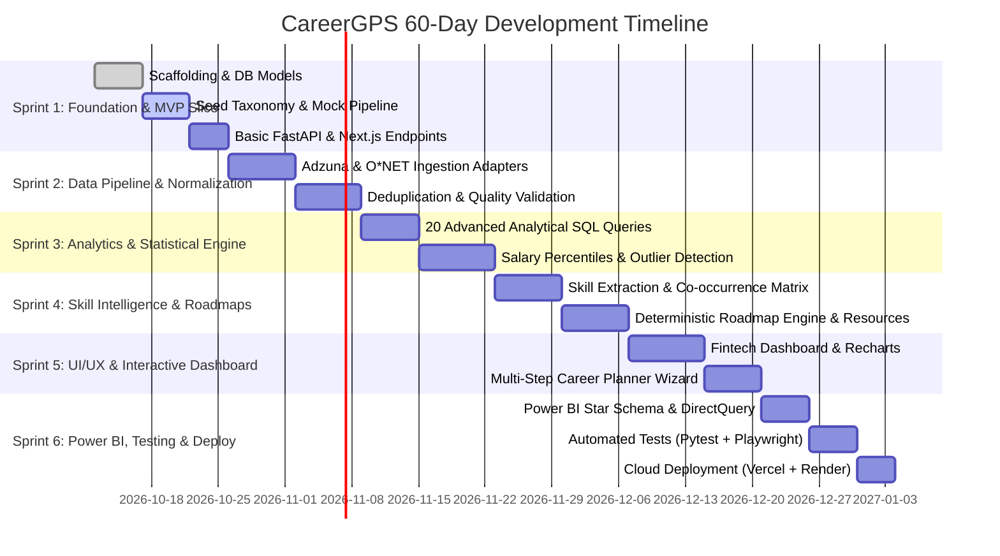

# CareerGPS — 60-Day Engineering Plan & Implementation Backlog

**Developer Allocation**: 1 Student Engineer  
**Pacing**: 2–3 Hours Daily (~15–20 Hours/Week)  
**Total Estimated Window**: 60 Days (Divided into 6 Bi-Weekly Sprints)

---

## 📅 Bi-Weekly Milestone Roadmap

---

## 📋 Comprehensive Backlog Items

### Phase 1: Core Foundation & Vertical Slice (Days 1–10) [IN PROGRESS]
- [x] Repository scaffolding with Next.js 15, FastAPI, and shared schemas.
- [x] Initial PostgreSQL relational schema & models.
- [x] Data taxonomy dictionaries (6 roles, 4 countries, 40+ canonical skills).
- [x] Health check and data verification endpoints.

### Phase 2: Ingestion, Validation & Lineage (Days 11–22)
- [ ] Implement `AdzunaAdapter` with rate-limiting, backoff, and pagination.
- [ ] Implement `ONetAdapter` and `ESCOAdapter` for skill dictionaries.
- [ ] Ingestion run tracking (`data_ingestion_runs`) with error logging.
- [ ] Conservative deduplication pipeline based on SHA-256 fingerprinting.

### Phase 3: Analytical SQL & Statistical Engine (Days 23–34)
- [ ] Author 20 documented analytical SQL queries with EXPLAIN plans.
- [ ] Build salary percentile calculation engine (P10, P25, Median, P75, P90, IQR).
- [ ] Currency conversion layer (USD, GBP, EUR, INR) with timestamped rates.
- [ ] Missingness & sample size guardrails ($N < 10$ warnings).

### Phase 4: Skill Intelligence & Recommendation Engine (Days 35–44)
- [ ] Fast dictionary-based skill extractor with regex word-boundary matching.
- [ ] Skill demand frequency and co-occurrence matrix calculator.
- [ ] Prerequisite dependency DAG for the 6 core careers.
- [ ] Verified learning resources catalogue (free Coursera, edX, MDN, Kaggle, official docs).
- [ ] Deterministic roadmap generator with optional LLM synthesizer.

### Phase 5: High-Fidelity UI/UX & Dashboards (Days 45–52)
- [ ] Custom dark theme token design in Tailwind CSS.
- [ ] Career Intelligence Dashboard: Posting count, salary percentiles, skill heatmap.
- [ ] Multi-Step Career Planner Wizard with state preservation.
- [ ] Printable / PDF export layout for personalized roadmaps.
- [ ] PostHog event instrumentation for conversion funnels.

### Phase 6: Power BI, Testing & Production Release (Days 53–60)
- [ ] Analytical Star Schema views for Power BI DirectQuery.
- [ ] Comprehensive unit tests (`pytest` for API and transformations).
- [ ] End-to-end user journey tests with Playwright.
- [ ] Deployment to Vercel (Web) and Render (API) with Supabase PostgreSQL.
