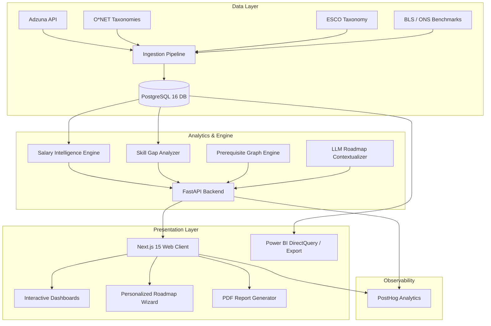

# CareerGPS — System Architecture & Technical Specifications

## 1. System Overview & Component Topology

CareerGPS is architected as a decoupled, modular analytics platform designed for high reproducibility, low operational cost, and strict data provenance.

---

## 2. Component Specifications

### 2.1 Web Frontend (`apps/web`)
- **Framework**: Next.js 15 (React 19, App Router)
- **Styling**: Tailwind CSS v3/v4 with custom fintech dark theme variables (`#080B14`, `#101625`, `#161E30`, `#6366F1`, `#06B6D4`)
- **Data Fetching**: TanStack Query (React Query) + typed fetch clients
- **Charts**: Recharts & custom SVG visualizers for percentile plots, radar skill matrices, and co-occurrence graphs.
- **Form State**: Zod schema validation for user career targets, timelines, and study availability.

### 2.2 API Backend (`apps/api`)
- **Framework**: FastAPI (Python 3.11) with ASGI Uvicorn
- **ORM & Migrations**: SQLAlchemy 2.0 (Declarative Base) + Alembic
- **Validation**: Pydantic v2 schemas for all request/response boundaries
- **Security**: Rate limiting (SlowAPI), CORS middleware, sanitized SQL statements, and strict parameterization.

### 2.3 Data Pipelines (`pipelines/`)
- **Extract**: Modular adapter pattern (`AdzunaAdapter`, `ONetAdapter`, `ESCOAdapter`).
- **Transform**: Currency normalization, annualization rules, deduplication (SHA-256 canonical hash across title, company, location, date).
- **Validation**: Great Expectations / Pydantic schema validation for clean batch loads.

### 2.4 Analytical & ML Engine (`ml/` & `analytics/`)
- **Salary Statistical Engine**: Calculates parametric (mean, std) and non-parametric (median, IQR, p10, p25, p75, p90) values, bootstrapping confidence intervals when $N \ge 30$.
- **Skill Extraction**: Exact dictionary matching + alias resolution with O*NET and ESCO taxonomies.
- **Hybrid Recommendation Engine**: Computes urgency and market weight:
  $$\text{PriorityScore}(s) = w_d \cdot \text{DemandFreq}(s) + w_u \cdot \text{RoleCentrality}(s) - w_p \cdot \text{PrereqPenalty}(s)$$
  coupled with LLM schema-constrained JSON generation.

---

## 3. Deployment Topology
- **Web**: Vercel (Edge CDN)
- **API**: Render / Railway (Docker container)
- **Database**: Supabase / Neon PostgreSQL 16 (Free/Hobby Tier)
- **Telemetry**: PostHog Cloud (Free Tier)
