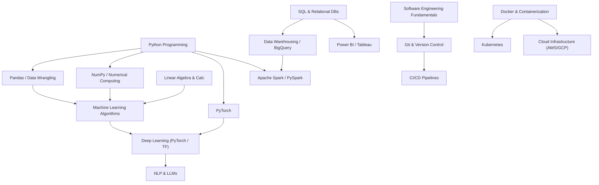

# Skill Prerequisite Knowledge Graph

## 1. Graph Architecture

The CareerGPS Skill Prerequisite Knowledge Graph is modeled as a strict **Directed Acyclic Graph (DAG)**:

$$G = (V, E)$$

- **Vertices ($V$)**: Distinct technical competencies, programming languages, analytical methodologies, and frameworks.
- **Edges ($E$)**: Directed prerequisite dependencies, where an edge $(u, v)$ signifies that skill $u$ is a required cognitive or technical prerequisite for skill $v$ ($u \rightarrow v$).

The graph is curated in [`data/dictionaries/skill_prerequisites.json`](file:///c:/Users/sheik/Documents/ds%20project/data/dictionaries/skill_prerequisites.json) and managed via the `SkillKnowledgeGraph` engine in [`ml/recommendations/knowledge_graph.py`](file:///c:/Users/sheik/Documents/ds%20project/ml/recommendations/knowledge_graph.py).

---

## 2. Graph Definition & Canonical Edge Mappings

The engine maintains verified dependencies across Data Science, Software Engineering, Analytics, Machine Learning, and Cloud infrastructure:



### Edge Listing & Rationale

| Upstream Prerequisite ($u$) | Downstream Skill ($v$) | Est. Hours ($u$) | Educational Rationale |
| :--- | :--- | :---: | :--- |
| `Python` | `Pandas` | 40h | Vectorized operations require standard Python syntax and control flow. |
| `Python` | `NumPy` | 40h | Array manipulation builds upon Python primitives. |
| `NumPy` | `Machine Learning` | 30h | ML estimators rely fundamentally on matrix dot products and tensor representations. |
| `Pandas` | `Machine Learning` | 35h | Feature extraction and tabular preprocessing require Pandas fluency. |
| `Linear Algebra` | `Machine Learning` | 45h | Gradient descent and loss surface geometry require multivariable calculus and matrix operations. |
| `Machine Learning` | `Deep Learning` | 50h | Neural networks generalize logistic regression, cost functions, and regularization. |
| `Deep Learning` | `NLP` | 45h | Modern NLP architectures (Transformers) operate on attention layers and embeddings. |
| `Deep Learning` | `Computer Vision` | 45h | CNNs and visual encoders require deep representation learning. |
| `SQL` | `Data Warehousing` | 35h | Dimensional modeling and star schemas assume relational query mastery. |
| `SQL` | `Power BI` / `Tableau` | 35h | Efficient visual dashboards require optimized aggregations and query semantics. |
| `Git` | `CI/CD` | 20h | Continuous delivery pipelines trigger from VCS branch events. |
| `Docker` | `Kubernetes` | 30h | Container orchestration requires containerization mastery. |

---

## 3. Algorithmic Integrity & Cycle Prevention

To maintain strict acyclicity, the graph engine executes automated validation during initialization:

1. **Cycle Detection**:
   ```python
   nx.is_directed_acyclic_graph(self.graph)  # Must evaluate to True
   ```
   If any cyclic dependency is introduced (e.g., $A \rightarrow B \rightarrow C \rightarrow A$), validation fails immediately with an explicit error.
2. **Missing Ancestor Traversal**:
   Given any skill $s$, `get_all_prerequisites(s)` performs depth-first traversal of the reversed graph to locate all transitive ancestors:
   $$\text{Ancestors}(s) = \{u \in V \mid \exists \text{ path } u \rightsquigarrow s\}$$
3. **Kahn's Topological Sort**:
   When ordering a student's learning roadmap, in-degree calculation schedules node dependencies such that foundational roots (in-degree 0) are acquired prior to dependent sinks.
