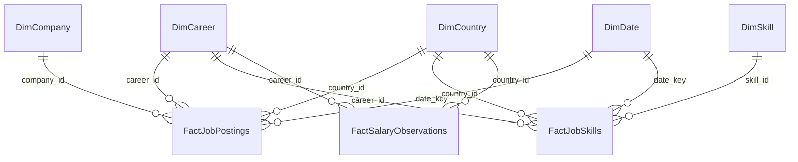

# CareerGPS — Power BI Analytical Architecture & Modeling Guide

This document defines the analytical reporting layer designed for **Power BI Desktop**, enterprise reporting, and portfolio demonstration.

---

## 1. Dimensional Architecture (Star Schema)

The reporting data layer is structured as a Kimball-style Star Schema, separating business processes (Facts) from context (Conformed Dimensions):



### Table Definitions & Grain
1. **`bi_fact_job_postings`**: Grain is one row per unique job posting. Contains measures: `salary_min`, `salary_max`, `normalized_annual_salary`, `has_salary_disclosure`.
2. **`bi_fact_job_skills`**: Grain is one row per skill instance attached to a posting. Links `posting_id` to `skill_id`.
3. **`bi_fact_salary_observations`**: Grain is one row per granular salary observation log.
4. **Dimensions**: `bi_dim_career`, `bi_dim_country`, `bi_dim_company`, `bi_dim_skill`, `bi_dim_data_source`, `bi_dim_date`.

---

## 2. Recommended DAX Measures

```dax
-- Total Postings Measure
Total Postings = 
COUNTROWS('bi_fact_job_postings')

-- Distinct Companies Hiring
Distinct Employers = 
DISTINCTCOUNT('bi_fact_job_postings'[company_id])

-- Median Annual Salary (Safeguarded against outliers)
Median Annual Salary = 
MEDIAN('bi_fact_job_postings'[normalized_annual_salary])

-- Salary Disclosure Rate (%)
Salary Disclosure Rate = 
DIVIDE(
    CALCULATE(COUNTROWS('bi_fact_job_postings'), 'bi_fact_job_postings'[has_salary_disclosure] = 1),
    COUNTROWS('bi_fact_job_postings'),
    0
) * 100

-- Skill Demand Frequency (%)
Skill Demand Percentage = 
DIVIDE(
    DISTINCTCOUNT('bi_fact_job_skills'[posting_id]),
    CALCULATE(DISTINCTCOUNT('bi_fact_job_postings'[posting_id]), ALLSELECTED('bi_dim_skill')),
    0
) * 100

-- Average Skills Required per Job Posting
Average Skills Per Posting = 
DIVIDE(
    COUNTROWS('bi_fact_job_skills'),
    DISTINCTCOUNT('bi_fact_job_skills'[posting_id]),
    0
)
```

---

## 3. Connecting Power BI to CareerGPS

### For Local SQLite (`careergps.db`):
1. Install the official **SQLite3 ODBC Driver** (by Christian Werner).
2. Open **Power BI Desktop** -> **Get Data** -> **ODBC**.
3. Select SQLite ODBC Driver and specify:
   `database=C:\Users\sheik\Documents\ds project\apps\api\careergps.db`
4. Select all `bi_*` views.

### For Production PostgreSQL (Render / Supabase / Neon):
1. Open **Power BI Desktop** -> **Get Data** -> **PostgreSQL Database**.
2. Enter your Host, Database (`careergps`), and Port `5432`.
3. Select **DirectQuery** or **Import**.
4. Load the `bi_*` views and set relationships according to the diagram above.
